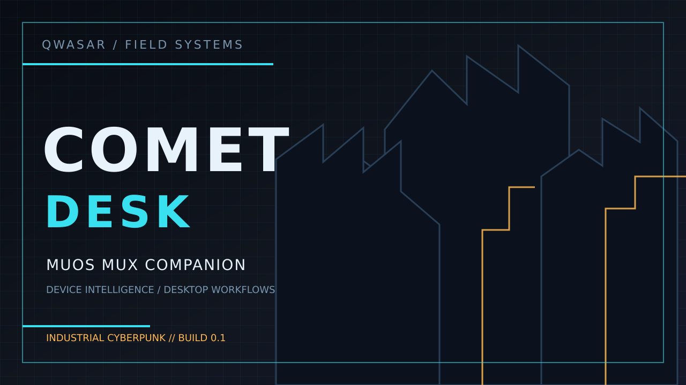

# COMET DESK




**A fast, focused desktop companion for muOS — part of the QWASAR ecosystem.**

Comet Desk is a lightweight MUX application for supported ARM64 handhelds. It owns a persistent Debian GNU/Linux 13 (Trixie) ARM64 root filesystem with APT, a default labwc session and optional X11/Wayland desktop profiles. Its software centre, THE FORGE, manages curated packages inside that Debian environment while muOS remains the host.

> **Project status:** `0.7.1-dev` reliability line. The first self-contained RG35XX H muOS `.muxapp` has been built by CI and its archive, AArch64 runtime payloads and SHA-256 checksum have been verified. Physical-device validation is still the release gate; a green CI run is not hardware certification.

## What it is

The app and documentation share one visual identity: industrial megastructure artwork, a restrained cyan/violet/amber palette, angular navigation marks and compact controller-first layouts. See the [visual identity guide](docs/VISUAL_IDENTITY.md) and [screenshot evidence policy](docs/SCREENSHOTS.md).


- A compact, standalone MUX app in the QWASAR family.
- Built with LÖVE 11.5 and Lua, informed by practical work on [Void Desk](https://github.com/SilverCrow2323/Void-Desk-Project).
- Designed around the muOS Andromeda experience and H700-class handhelds.
- Intentionally smaller in scope than Void Desk: quick to launch, quick to navigate, and focused on a few reliable jobs.

## First targets

- Anbernic RG35XX H (Allwinner H700, ARM64, 640×480).
- Related H700 devices will be added only after their display, controls and storage paths are verified.

## Initial modules

| Module | Purpose | Current state |
|---|---|---|
| Overview | Device/app landing screen | Implemented |
| Desktop System | Build Debian Trixie ARM64 + APT and install labwc/XFCE/LXDE/LXQt/IceWM/Fluxbox/Openbox profiles | Integrated setup/session manager; hardware validation pending |
| APP DECK | Discover and launch installed Debian GUI applications under Comet supervision | Integrated registry and supervised launcher; physical application validation pending |
| THE FORGE | Discover, install, update and remove curated Debian APT packages | Integrated catalogue and package operations; device validation pending |
| System Tools | Read-only Debian, APT, profile and application-registry status | Integrated status dashboard |
| Uplink | Wi-Fi, hotspot, Bluetooth, muOS Web Services and Rt:Tailscale-M | Integrated status and installer; hardware validation pending |
| Diagnostics | Live device/storage snapshot and opt-in privacy-safe report export | Implemented; CI/package checks pass; physical-device validation pending |

## Safety principles

1. muOS remains the host system; Comet Desk does not replace its boot chain.
2. Desktop payloads must use an explicitly selected target location.
3. No formatting, partitioning, deleting or overwriting without a clear preview and confirmation.
4. Installation must be staged, validated and recoverable.
5. Device-specific paths and capabilities must be detected, not guessed.
6. Until a workflow is implemented and tested, the UI must label it as unavailable rather than simulate success.

## Development

The current prototype is a pure LÖVE/Lua interface and can be opened on a desktop with LÖVE 11.5:

```sh
love love
```

The app bundles its low-memory background, six-tile PNG icon atlas and transparent PNG wordmark; source artwork and documentation graphics live beside the project docs. The visual system is documented in [Visual identity](docs/VISUAL_IDENTITY.md).

Every device-test milestone is distributed as an installable `.muxapp`. The package builder pins and validates the AArch64 LÖVE runtime, includes the muOS launcher, and publishes a SHA-256 checksum with the GitHub Actions artifact. See [MUX App build and install](docs/MUXAPP_BUILD.md).

## Project relationship

```text
QWASAR
├── Void Desk      — desktop reference implementation and shared H700 research
├── Rt:Tailscale-M — optional muOS-managed Tailscale service stack
└── Comet Desk     — standalone muOS MUX app, Debian/ APT desktop engine, THE FORGE and Uplink
```

Comet Desk owns the Debian rootfs and desktop lifecycle: it downloads a checksum-pinned Debian Trixie ARM64 base, installs APT and the selected desktop profile, mounts and launches sessions, and returns to the Comet UI. THE FORGE is a Discover/Software-style package centre with an allowlisted H700-oriented catalogue. It never operates on muOS's host APT database. Uplink reads muOS Andromeda state and can install Rt:Tailscale-M; the RT service manager remains the sole owner of the Tailscale daemon.

## Reference hardware

The first target is the **Anbernic RG35XX H running muOS Andromeda 2606.0**: Allwinner H700, AArch64, 1 GB RAM, 640×480 display and a 64 GB nominal TF1 baseline. The 64 GB figure is a reference configuration, not a limit. TF1 replacements and optional TF2 expansion cards are discovered at runtime; installation sizing must use the selected filesystem's live free space.

- [RG35XX H device profile](docs/DEVICE_PROFILE.md)
- Device-side read-only probe: `love/device_probe.lua` (bundled in the MUX App).
- Python reference probe: `python3 service/device_probe.py` (host-side development checks).

## Documentation

- [Product blueprint — Comet Desk 1.0](docs/PRODUCT_BLUEPRINT.md)
- [Release gates and hardware acceptance matrix](docs/RELEASE_GATES.md)
- [Architecture](docs/ARCHITECTURE.md)
- [Roadmap](docs/ROADMAP.md)
- [Safety model](docs/SAFETY.md)
- [Debian desktop and APT](docs/DESKTOP_ENVIRONMENT.md)
- [THE FORGE package centre](docs/FORGE.md)
- [APP DECK — Comet-managed Debian applications](docs/APP_DECK.md)
- [Visual identity](docs/VISUAL_IDENTITY.md)
- [Screenshot evidence guide](docs/SCREENSHOTS.md)
- [Asset inventory](assets/README.md)

All user-facing interface text and project documentation are written in English.
